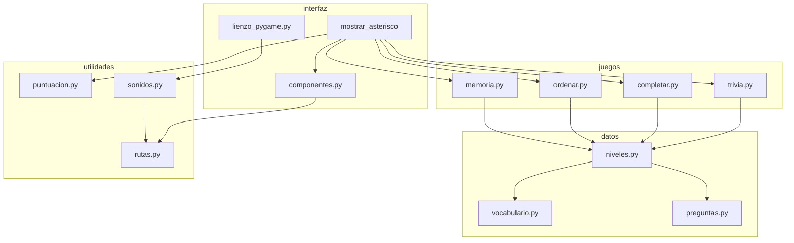
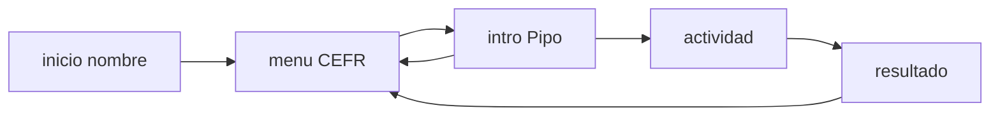
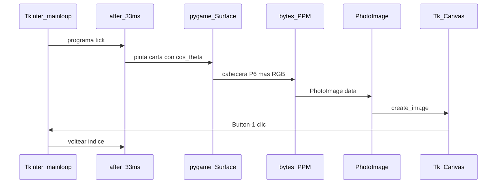

# Arquitectura de Penguin English Adventure

Documento académico: capas, flujo de una ronda y el puente pygame↔Tkinter.
Relato de construcción: [CONSTRUCCION.md](CONSTRUCCION.md).
Librerías: [LIBRERIAS.md](LIBRERIAS.md).

---

## Capas

La interfaz **importa** juegos; los juegos **no** importan interfaz. Así
las reglas se prueban sin display.

```
datos/          contenido (vocabulario, trivia, CEFR)
    ↑ leen
juegos/         reglas puras (sample, shuffle, parejas)
    ↑ importan
interfaz/       pantallas Tkinter + lienzo 2.5D
    ↑ usan
utilidades/     puntos, sonidos, rutas
```



### ¿Por qué Tkinter no se sustituye por pygame?

El proyecto enseña el puente PSeInt → Python → GUI de biblioteca
estándar. pygame entra como **dependencia única** para audio y para
pintar cartas. Los menús, el teclado y el tema siguen en Tk porque el
estudiante ya sabe `Label` / `Button` / `after`.

---

## Flujo de una ronda



1. `crear_ventana` deja el cascarón y `mostrar_inicio`.
2. El nombre (`strip`) abre `mostrar_menu`.
3. A1/A2/B1 escribe `puntuacion.nivel_actual` y redibuja el menú
   (las categorías y los cupos cambian).
4. Un botón de actividad abre `mostrar_intro` (Empezar o Volver).
5. `iniciar_*` construye el estado con `juegos/` y llama a `mostrar_*`.
6. Cada respuesta **repinta** la misma pantalla con parámetros nuevos
   (no hay máquina de estados oculta).
7. Al terminar: `completar_actividad`, `sumar_bonificacion`,
   `mostrar_resultado`, vuelta al menú.

Vocabulario no puntúa; se marca visitado al entrar.

El cascarón (`_header` + canvas) sobrevive a los pasos 4–7. Solo se
vacía `_contenido`.

---

## Dos bucles, un dueño

Tkinter tiene `mainloop`. pygame tiene el suyo. Si se mezclan, un bucle
come los eventos del otro.

Solución: **pygame no abre ventana**.



Contrato:

- pygame dibuja en una `Surface` RGB en RAM (`pygame.init` sin display).
- `superficie_a_ppm` escribe `P6 ancho alto 255` + bytes.
- Tk pega esa foto en un `Canvas` y recibe el clic.
- `after(33, tick)` anima ~30 fps. No hay `time.sleep` ni
  `pygame.event.pump` bloqueante.
- Si `Surface` no se puede crear, el mismo widget dibuja rectángulos en
  el Canvas. La API (`voltear`, `proxies`) no cambia: los tests no
  dependen de SDL.

Audio: `inicializar_motor()` en `crear_ventana()` (hilo principal). El
hilo daemon solo hace `Sound.play()`. Si el mixer falla,
`audio_disponible()` es False y el encabezado muestra "Sin sonido".

---

## Volteo 2.5D

Ángulo θ alrededor del eje Y (proyección **ortográfica**, no un motor
3D):

- `ancho_visible = |cos θ| · ancho` (mínimo 2 px, el canto)
- `frente` si `cos θ ≥ 0`, si no `dorso`
- sombra al canto: `1 - |cos θ|`

Cabe en una defensa oral de dos minutos: es el coseno de secundaria.

---

## Estado y nivel CEFR

El progreso es de **sesión**: variables de módulo en `puntuacion.py`.
No hay archivo ni base de datos.

`nivel_actual` (default A2). `datos.niveles.filtrar_por_nivel` es
acumulativo. Las constantes de rondas/parejas/flip salen de `PARAMETROS`.
Ver [CEFR.md](CEFR.md).

---

## Empaquetado

El árbol congelado replica las capas: `PenguinEnglish.exe` arranca
`lanzar.py` → `iniciar()`. `recursos/` viaja como `datas` de PyInstaller
y se resuelve con `sys._MEIPASS`. Detalle en [CONSTRUCCION.md](CONSTRUCCION.md)
paso 10 y [LIBRERIAS.md](LIBRERIAS.md) fichas 12–14.
